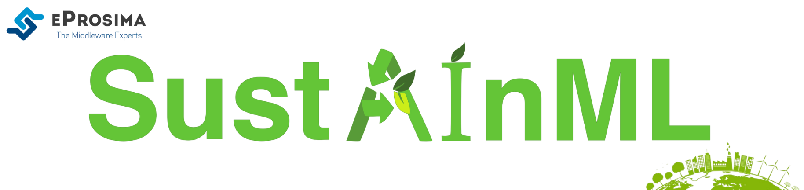

[](https://sustainml.eu/)

<br>

<div class="menu" align="center">
    <strong>
        <a href="https://eprosima.com/index.php/downloads-all">Download</a>
        <span>&nbsp;&nbsp;•&nbsp;&nbsp;</span>
        <a href="https://sustainml.readthedocs.io/en/latest">Docs</a>
        <span>&nbsp;&nbsp;•&nbsp;&nbsp;</span>
        <a href="https://sustainml.eu/showroom/news">News</a>
        <span>&nbsp;&nbsp;•&nbsp;&nbsp;</span>
        <a href="https://www.linkedin.com/company/eprosima/">LinkedIn</a>
        <span>&nbsp;&nbsp;•&nbsp;&nbsp;</span>
        <a href="mailto:info@eprosima.com">Contact Us</a>
    </strong>
</div>

<br><br>

<div class="badges" align="center">
    <a href="https://www.gnu.org/licenses/gpl-3.0.html#license-text"></a>
    <a href="https://github.com/eProsima/SustainML-Framework/releases"></a>
    <a href="https://github.com/eProsima/SustainML-Framework/issues"></a>
    <a href="https://github.com/eProsima/SustainML-Framework/network/members"></a>
    <a href="https://github.com/eProsima/SustainML-Framework/stargazers"></a>
    <a href="https://SustainML.readthedocs.io/en/latest/"></a>
</div>

<br><br>

*SustainML* is a framework and an associated toolkit that fosters energy efficiency throughout the life-cycle of ML applications.
Starting from a description of the user's problem and constraints, it proposes a machine learning model, estimates the resources that model needs on the chosen hardware, and the energy and carbon footprint of running it, so that different model and hardware choices can be compared.

AI developers from all experience levels can make use of the framework through its emphasis on human-centric interactive transparent design and functional knowledge cores, instead of the common blackbox and fully automated optimization approaches in AutoML.

---

## Features

* **Problem definition from natural language**: the ML goal is inferred from the problem description (with a local `llama3` model through Ollama), or chosen by hand.
* **Model proposal**: Hugging Face models from a knowledge graph (Neo4j) and a semantic search (RAG), YOLO models for the Axelera board, and U-Net models for the FPGA; a model can also be picked by hand.
* **Hardware evaluation**: latency, power and memory of the model on the UPMEM processing-in-memory simulator, on the Axelera Edge 130p (measured YOLO models), or on an FPGA (U-Net models measured by DFKI, or estimated with DFKI's predictor).
* **Energy and carbon footprint** per inference, with the grid carbon intensity of the chosen country (or of the country detected from the public IP address).
* **Several output models and automatic reiteration**: the framework can search further models when a result exceeds the desired carbon footprint or the maximum memory footprint.
* **Results comparison**: overview and ranking of the results, metric comparisons and fingerprint radar charts.
* **Hugging Face models**: search by description, model details, and side by side comparison of up to 5 models.
* **YOLO and U-Net model explorers** for the Axelera board and the FPGA.
* **Dataset description**: a CSV or JSON dataset is profiled and described to help define the problem.
* **Save and load** of the results, the problem definitions and the Hugging Face searches and comparisons.

### Framework Architecture

The *SustainML Framework* is composed of a Qt/QML GUI, a backend (a REST server that hosts the orchestrator), and six module nodes, each specialized in one part of the problem:

1. **App Requirements** and **ML Model Metadata**: encode the problem and constraints defined by the user, and find the ML goal.
2. **ML Model Provider**: propose a machine learning model.
3. **HW Constraints** and **HW Resources Provider**: evaluate the model on the chosen hardware.
4. **Carbon Footprint**: estimate the energy and carbon footprint of the model on that hardware.

The nodes communicate through [eProsima Fast DDS](https://www.eprosima.com/index.php/products-all/eprosima-fast-dds), and each one is a Python program built on the SustainML library, which hides the DDS communications.
See the [documentation](https://sustainml.readthedocs.io/en/latest/) for the details of each node and the user manual of the GUI.

---

## Installation manual

The following sections describe the steps to install the SustainML Framework from sources on Ubuntu (the continuous integration of the SustainML Library and the Docker image use Ubuntu 24.04).
The Python dependencies (for example, `torch==2.4.1`) require Python 3.10, 3.11 or 3.12.
The full documentation is available on [Read the Docs](https://sustainml.readthedocs.io/en/latest/).

> [!IMPORTANT]
> The `sustainml-framework` launcher looks for the workspace in `~/SustainML/SustainML_ws`.
> Use that exact path, as in the commands below.

1. **Installing the dependencies**

    These packages provide the build tools, the Fast DDS dependencies, and the Qt 5.15 libraries and QML modules used by the GUI.

    ```bash
    sudo apt update && \
    sudo apt install --yes --no-install-recommends \
        curl wget git cmake g++ build-essential python3 python3-pip python3-venv libpython3-dev swig \
        libssl-dev libasio-dev libtinyxml2-dev libp11-dev libengine-pkcs11-openssl softhsm2 \
        qtdeclarative5-dev libqt5charts5-dev qml-module-qtcharts qtquickcontrols2-5-dev libqt5svg5 \
        qml-module-qtquick-controls qml-module-qtquick-controls2 qml-module-qt-labs-qmlmodels qml-module-qtquick-dialogs
    ```

    * Install Ollama and pull the `llama3` model, which the ML Model Metadata node, the Hugging Face MCP server of the ML Model Provider node, and the backend use through the local Ollama server (`http://localhost:11434`)

    ```bash
    curl -fsSL https://ollama.com/install.sh | sh && \
    ollama pull llama3
    ```

2. **Installing Neo4j**

    The ML Model Metadata and ML Model Provider nodes query a Neo4j graph database with the models knowledge base.
    Neo4j requires Java 21.

    * Install Java 21 and add it to the path (the `JAVA_HOME` below is the one of `amd64` machines)

    ```bash
    sudo apt install -y openjdk-21-jdk && \
    echo 'export JAVA_HOME=/usr/lib/jvm/java-21-openjdk-amd64' >> ~/.bashrc && \
    echo 'export PATH=$JAVA_HOME/bin:$PATH' >> ~/.bashrc && \
    source ~/.bashrc
    ```

    * Install the latest Neo4j

    ```bash
    sudo apt install -y gnupg ca-certificates wget && \
    wget -O - https://debian.neo4j.com/neotechnology.gpg.key | gpg --dearmor | sudo tee /usr/share/keyrings/neo4j.gpg > /dev/null && \
    echo "deb [signed-by=/usr/share/keyrings/neo4j.gpg] https://debian.neo4j.com stable latest" | sudo tee /etc/apt/sources.list.d/neo4j.list && \
    sudo apt update && \
    sudo apt install -y neo4j
    ```

3. **Downloading sources**

    * Create the workspace and a Python virtual environment, install the Python tooling, and fetch the SustainML repositories

    ```bash
    mkdir -p ~/SustainML/SustainML_ws/src && cd ~/SustainML && \
    python3 -m venv SustainML_venv && source SustainML_venv/bin/activate && \
    pip3 install -U colcon-common-extensions vcstool gdown && \
    cd ~/SustainML/SustainML_ws && \
    wget https://raw.githubusercontent.com/eProsima/SustainML-Framework/main/sustainml.repos && \
    vcs import src < sustainml.repos
    ```

    * Initialize the submodules (the nodes of work packages 1, 2 and 3) and install the Python dependencies of the nodes

    ```bash
    cd ~/SustainML/SustainML_ws/src/sustainml_lib && \
    git submodule update --init --recursive && \
    pip3 install -r ~/SustainML/SustainML_ws/src/sustainml_lib/sustainml_modules/requirements.txt
    ```

    * Download the ANN index of the models knowledge base (if it is missing, the ML Model Provider node downloads it to `~/.cache/sustainml` on its first start)

    ```bash
    cd ~/SustainML/SustainML_ws/src/sustainml_lib/sustainml_modules/sustainml_modules/sustainml-wp1 && \
    gdown 1TQvt1bSXares-I9l7Wki0Jge3oubRkOJ -O rag/models_index.ann
    ```

4. **Building the framework**

    Colcon is a command line tool based on CMake aimed at building sets of software packages.
    With the following command, colcon builds and installs the SustainML framework, and sources the generated libraries and applications.

    ```bash
    cd ~/SustainML/SustainML_ws && \
    colcon build && \
    source ~/SustainML/SustainML_ws/install/setup.bash
    ```

    Then load the Neo4j database dumps: the `system` database (which holds the user credentials the nodes connect with) and the `neo4j` database (the knowledge base), with Neo4j stopped.

    ```bash
    NEO4J_BACKUP=$HOME/SustainML/SustainML_ws/src/sustainml_lib/sustainml_modules/sustainml_modules/sustainml-wp1/rag/neo4j_backup && \
    sudo systemctl stop neo4j && \
    sudo neo4j-admin database load system --from-path=$NEO4J_BACKUP --overwrite-destination=true && \
    sudo neo4j-admin database load neo4j --from-path=$NEO4J_BACKUP --overwrite-destination=true && \
    sudo chown -R neo4j:neo4j /var/lib/neo4j/data
    ```

5. **Deploying the framework**

    Before starting, set the `HF_TOKEN` environment variable to your personal Hugging Face access token.
    The backend reads it at start up (and warns if it is missing) and forwards it to the nodes that download models from the Hugging Face Hub, so that gated models can be loaded.

    ```bash
    export HF_TOKEN=<your_huggingface_token>
    ```

    All the nodes use the DDS domain `0` by default.
    To isolate several deployments, set the environment variable `SUSTAINML_DOMAIN_ID` to another domain ID.

    ```bash
    export SUSTAINML_DOMAIN_ID=<domain_id>
    ```

    Start the SustainML Framework, with the Python virtual environment activated and the workspace sourced.
    `sustainml-framework` starts Neo4j (with `sudo systemctl`, so it may ask for the `sudo` password), then the backend node, then the module nodes, and finally the GUI.
    When the GUI is closed, all the nodes and Neo4j are stopped.

    ```bash
    source ~/SustainML/SustainML_venv/bin/activate && \
    source ~/SustainML/SustainML_ws/install/setup.bash && \
    sustainml-framework
    ```

    The GUI alone is run with the `sustainml` command.

    The first run needs Internet access: the nodes download the Hugging Face models they analyze, and the Carbon Footprint node detects the country of the machine from its public IP address when the user does not choose one.
    The Axelera YOLO models catalog, the FPGA U-Net measurements and predictor, the UPMEM simulator and the Hugging Face MCP server are part of the node sources and need no extra setup, hardware or token of their own.

### Running SustainML Framework using Docker

The installation steps above can be skipped by using the [Dockerfile](docker/Dockerfile) of this repository, which builds an image with the whole framework, and the [Docker compose file](docker/docker-compose.yaml), which runs each node and the GUI in its own container.
Ollama, with the `llama3` model, must still be installed on the host.

To deploy the SustainML Framework with Docker, please refer to the [Docker instructions](docker/README.md).

## Getting Help

If you need support you can reach us by mail at [sustainml@eprosima.com](mailto:sustainml@eprosima.com) or by phone at `+34 91 804 34 48`.

---

<a href="https://sustainml.eu"></a>
This project has received funding from the European Union’s Horizon Europe research and innovation programme (HORIZON-CL4-2021-HUMAN-01) under grant agreement No 101070408.
